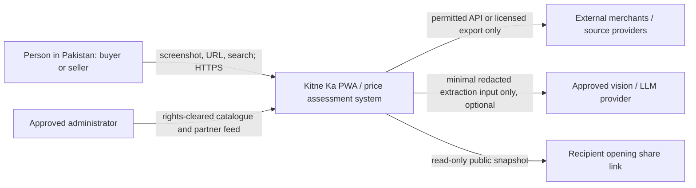
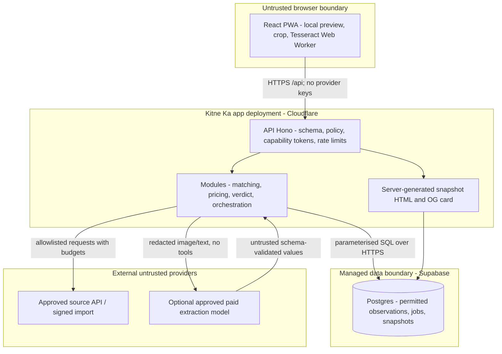

# ADR-0002 — MVP stack, extraction and evidence architecture
- Current launch override: **SecOps revision below: local-only OCR + mandatory confirmation; remote images/models OFF; separate staging/production; 1h/24h/30d retention.** Earlier optional-provider sections are future alternatives, not launch permission.
- Status: **Proposed**, domain boundaries CTO-endorsed; final acceptance at G2 (12 Nov 2026 PKT), vendor commitments/spend require Founder approval.
- Date: 9 Nov 2026 PKT. Deciders: CTO; Design Director for UX contract; DevOps/Security for runtime/privacy; Founder for spend/vendors.
- Inputs: Founder brief §6; GitHub `musmanj/kitne-ka-hq` docs/01-14-day-plan.md, docs/03-engineering-standards.md, architecture/adr/0001-modular-monolith-default.md (read successfully through connector); Design spec §4; PM source scan.

## Context and constraints
Pakistan PKR PWA, three categories, screenshot/link/search → confirmation → sourced assessment or honest insufficient data. 14 calendar days; Day 1 Mon 9 Nov; build starts Day 3 Wed 11 Nov; G2 Thu 12 Nov; feature freeze Wed 18 Nov; G4 Sat 21 Nov; live URL Sun 22 Nov PKT. G1 Tue 10 Nov. Repository plan is stale (“Day 1 TBD”, “every day of delay moves Day 14”); **Founder-dated brief overrides it**. No deadline movement without Founder approval. Preparatory domain/test foundations today are not permission to bypass scope gates.

Largest risk is licensed evidence, NOT model sophistication. No microservices, vector database, orchestration platform, generic plugin framework or long-running browser scraper. LLMs may extract/normalise given facts; **never produce market prices, fill missing observations, decide matching hard facts or compute verdicts**. Extracting a visible asking price from an image is allowed; inventing a market price is not.

## ADR-0001 review verdict
**Accept architectural direction with clarifications**: one deployable modular monolith, framework-independent business logic and adapters are appropriate. Update stale context/date to confirmed product; “serverless functions only” is a deployment style, not inherently incompatible with a monolith—one Worker hosting modules is still a single deployable. “Per-module tables” must not create unnecessary databases/schemas. No actual GitHub modification/status transition was made; this file records CTO review for the repo owner to apply through review.

## Options evaluated
| Option | Delivery / cost / operational trade-off | Verdict |
|---|---|---|
| A. Next.js full-stack TypeScript; Vercel Pro + Supabase Free (or Neon Free) | One language, SSR/OG templates and previews convenient; minimal API plumbing. Vercel Hobby explicitly **non-commercial personal only**; cannot assume startup MVP qualifies. Pro $20/month plus metered overage; one deployer assumed. Supabase supplies Postgres/storage/auth but extra capabilities not needed initially | Strong alternative if Founder approves spend and Engineer prefers Next; do not force SSR across private app flows |
| B. FastAPI Python backend + React/Vite PWA, Postgres | Mature Python OCR/data ecosystem, readable numeric domain tests; two languages/deployables, CORS/contracts, backend hosting and native OCR CPU add work. No measured extraction advantage; hosting cost unknown until vendor selected | Reject for 14-day default; reconsider only if existing team/code strongly favours Python or local OCR becomes a backend requirement |
| **C. React/Vite TS PWA + Hono API, one Cloudflare Worker with Static Assets + Supabase Free Postgres** | One repo, one language, one app deployment (static assets + API), no SSR requirement for app. Free Worker 100k requests/day but 10ms CPU/invocation: keep OCR in browser/provider, small bounded pricing arrays and Web APIs only. Static share HTML generated server-side from safe snapshot; predesigned server-rendered PNG OG card at share creation (SVG template; rasteriser CPU must be measured). Requires runtime compatibility smoke, CPU evidence and approved cloud account | **Recommend** for free-first MVP; Cloudflare docs explicitly support static SPA + API in same deploy. Gate fallback A if runtime compatibility blocks and Founder approves $20, rather than spending days on deployment adapters |

### Decision
Recommend C: React, TypeScript strict, Vite, Hono, Zod boundary schemas, SQL migrations/Postgres (Supabase Free), server-side parameterised data access over HTTPS, Vitest domain tests, Playwright limited core E2E, ESLint/Prettier, ICU message catalogues, CSS logical properties. No auth for anonymous checks; a separately protected admin import route or offline import process, not public admin. No account creation required for demo scaffolding; provisioning waits for approval. Pin compatible supported package versions during implementation (not fabricated here). No stored original screenshots or raw OCR/provider responses. Launch images never leave device; only schema-validated, user-confirmed product facts cross the API.

If Founder mandates a truly $0 production bill, disable paid extraction fallback and search APIs; browser OCR/manual confirmation stays functional but this is a product-quality trade-off requiring G1 acceptance. A valid live URL on provider subdomain needs no purchased domain.

## Extraction / LLM options and official pricing
Fetched official pages **9 Nov 2026 PKT**; prices USD, taxes/FX excluded. These are published rates, **not quality benchmarks**; model availability/quota must be tested with approved account before G2. Do not choose deprecated models merely because cheap. Pricing page redirects from ai.google.dev to aistudio.google.com observed in this assessment.

| Choice | Official standard price and limits | Trade-offs / decision |
|---|---|---|
| Tesseract / browser Tesseract.js | No API licence fee; [Apache-2.0 engine licence](https://raw.githubusercontent.com/tesseract-ocr/tesseract/main/LICENSE); [browser capability](https://tesseract.projectnaptha.com/) | **Primary OCR** in lazy-loaded browser Web Worker; image stays local; deterministic parser + confirmation. Download/language-model weight and low-end phone latency are unmeasured. Does not intrinsically understand product identity/Urdu images; manual fallback always present. Do not run native OCR on 10ms edge CPU |
| **Google Gemini 3.5 Flash-Lite** | [Official pricing](https://ai.google.dev/gemini-api/docs/pricing), final https://aistudio.google.com/docs/pricing: standard input text/image/audio/video **$0.30/M tokens**, output including thinking **$2.50/M**. Free tier marked free; input/output used to improve products **Yes** free / **No** paid. [Rate limits](https://ai.google.dev/gemini-api/docs/rate-limits) vary by model/project and are visible in approved account; no universal RPM/RPD promised | **Recommended optional normalisation/vision fallback on paid tier only**, subject to Founder and privacy approval + rights-cleared evaluation. Server-side key, strict schema, no web grounding/tools. Send cropped/redacted product region, or minimal OCR text. Free tier only synthetic/non-sensitive approved fixtures, never real private user screenshots |
| OpenAI GPT-4.1 mini | [Official pricing](https://developers.openai.com/api/docs/pricing): input **$0.40/M**, output **$1.60/M**, cached input $0.10/M. Image token metering affects bill; no durable free production allowance assumed. [Data controls](https://developers.openai.com/api/docs/guides/your-data): API data not used for training by default; abuse logs up to 30 days; use `store:false`, not a zero-retention claim | Credible alternate extraction adapter; pilot same fixture set if Gemini poor or unavailable. No dual-provider automatic fanout in MVP. Not selected solely on cost—at assumed output length it may be cheaper; choose quality/privacy availability at G2 |
| Google Cloud Vision Text / Document Text Detection | [Official pricing](https://cloud.google.com/vision/pricing): first **1,000 units/month free per feature**, then **$1.50/1,000** up to 5M (default consumption, not committed discounts). Each requested feature/page may bill a unit; storage/other GCP services extra | Specialised OCR alternative; still needs identity/normalisation and confirmation. No evidence it beats Tesseract on our screenshots yet. Billing-account/vendor approval required even within free units |

### Provisional provider selection test
Day 2–3: rights-cleared English/Roman Urdu screenshot set across all categories including multiple products, low resolution, “1 lac”, non-PTA/JV, EMI and decoy instructions. Proposed minimum 30 fixtures, no accuracy claim. Record per-field exactness and critical false matches, latency distribution (cold/warm), token usage and privacy behaviour. Critical missing variant must ask user, never guess. Prefer Gemini paid if it meets PM/QA agreed acceptance; OpenAI alternate if materially better or unavailable. If neither approved, manual-confirmation route remains, and PM explicitly decides whether that meets MVP “AI” expectation. Budget an explicit extraction cap; requests fail closed before exceeding it.

## Module boundaries (Clean/Hexagonal-lite)
- **category/catalogue** owns category config, canonical Product, Variant and aliases. Category schemas versioned; phone/laptop/console forms generated from config, no hardcoded category branches in pricing.
- **ingestion** owns SourceAdapter interface, permission registry/kill-switch, permitted API/feed adapters, upload/link input and extraction adapter. Adapter pattern justified by distinct external protocols. `discover`, `extract` and `collect` have separate capability permissions; a discovered URL is not fetch authority.
- **matching** normalises unit/spec facts, deduplicates, performs hard variant exclusion and emits auditable reason codes; accepts explicit category config.
- **pricing** pure functions for independent pools, IQR, quantiles, median and confidence; no DB/network/LLM dependencies.
- **verdict** pure threshold policy and deterministic explanation reason codes. A small module/function, not a network service.
- **assessment/application** orchestrates steps, cancellation, idempotency and data-versioned results; owns progress state. No durable workflow engine.
- **persistence** parameterised SQL repositories for catalogue, observation, source policy, job and snapshots. Clear module-owned access, DB migrations; no public browser service-role key. Short job/result records not raw screenshots.
- **API** validates typed contract (`03-api-contract-v0.md`), capability tokens, rate limits, retention classes, error mapping; **UI** renders states/progress, confirmation, confidence, sources and share. No client-side authority over prices/verdicts.

## C4 context (logical)

## C4 containers and trust boundaries

Containers are logical components: Hono/module/HTML code deploys together, not separately. DB and external vendors remain separate trust boundaries. PII-containing uploads never enter public static assets, snapshots or shared caches.

## Security and privacy
- HTTPS only; input size/rate limits; CSP, HSTS, safe output escaping, URL query redaction. Remote images/pages are untrusted data, never instructions; extraction has no tool access/secrets. Bound model tokens/time; validate JSON and numeric currency/variant values. Text in images cannot change source policy.
- Input proposal: max original 10MiB client-side, JPEG/PNG/WebP only, dimensions/pixel limits before decoding; **API limit 4MiB**, target <=1600px long edge. Decode/re-encode to strip EXIF; use browser-generated JPEG/PNG only and no original uploaded. Server validates file magic, rejects metadata-bearing/nonconforming containers and excessive dimensions, enforces independent 4MiB/4MP limits; malformed/non-normalised input rejected, not processed natively at edge. Implement verification tests. Never trust extension/MIME/client assertions. Crop/redact private chats/names/numbers before any remote processing.
- Retention proposal for Security approval: originals local only; remote redacted image buffered only for request, released on completion/cancel (target <=15 min upper bound); no object storage for MVP screenshot originals. Expire private job/temporary extraction fields within **24 hours** via scheduled cleanup. Retain licensed non-PII market observations only per source contract. No claim provider retention is zero; disclose selected vendor policy. Design must not promise “phone numbers aren't stored” when provider behaviour makes that false.
- URL analysis: strict allowlisted host/endpoint registry; no private/loopback/link-local IPs, userinfo, non-HTTPS, arbitrary ports, redirects to different/unapproved hosts or DNS rebinding. For OLX blocked pre-fetch with NOT_PERMITTED. No cookies/internal APIs, proxy evasion or user-agent spoofing.
- No public write access to observations/catalogue. Signed/capability-scoped jobs; random tokens kept in session memory, no personal account required; DB roles/RLS deny public access, service role only server secret. Log request IDs, durations, outcome/reason counts, source error rates; no URLs with private queries, OCR text, images or secrets.
- PWA caches static shell/assets only; no automatic offline API/result/image storage. Recent checks local device opt-in with clear/delete; no seller PII. `Intl.NumberFormat` en-PK/ur-PK currency PKR; ICU messages; `dir`, logical CSS. Explicitly test grouping rather than hardcoding a lakh/western format expectation.

## Jobs, failures and caching
**Polling, not SSE, in v0**: POST creates job; UI polls every 1 second initially then 2–5 seconds with jitter and Retry-After. Job stages map exactly to Design §4. Each bounded extraction/collection step is run by idempotent advance calls (see API); no reliance on keeping an edge process alive. Provider call wall timeout ~15s proposed; total pipeline ~30s soft deadline, cancel/fallback when exceeded. Targets: visual acknowledgment <1s; p50 end-to-end <10s is an aspiration to measure, not a benchmark. No fake percentages.

| Failure | Required behaviour |
|---|---|
| Source prohibits URL fetch | NOT_PERMITTED before any network read; offer manual entry; offer image input only with rights notice and policy gates |
| Vision timeout / bad JSON / rate cap | Keep local image and typed fields, return extraction error and manual confirmation; never invent identity or price |
| Ambiguous identity / multiple products | Return per-field confidence and candidates; user selects/confirms; no assessment against wrong pool |
| One provider fails or evidence stale | Use remaining eligible observations; recount independence/confidence. Below gate → INSUFFICIENT_DATA. Distinguish service failure from genuine no evidence |
| Database unavailable | Preserve inputs; return retryable SERVICE_UNAVAILABLE; do not fabricate “insufficient” if no collection could run |
| Worker CPU limit or job duplicate | Bounded arrays, indexed query, idempotent optimistic stage transitions. Measure in runtime. Duplicate calls do not double-charge provider |
| Share disclosure risk | User explicit share preview/confirmation; immutable public snapshot excludes screenshot, seller identity, raw listing URL by default. At least 128-bit cryptographic ID; 30-day expiry proposed, revoke capability; immutable payload but revocable availability |

Cache approved evidence by canonical variant/condition/PTA/location-policy and source-policy version. Collection cache TTL <=6h new /24h used (or licence stricter); derived assessment cache <=1h and no later than earliest hard evidence expiry; negative permission decisions cached until reviewed, transient empty results <=5min. Invalidate when source disabled, methodology/config changes or observation changes; retain retrieval vs observation dates separately. Use Postgres initially, not Redis. No private input in shared cache keys/payloads; snapshots are explicitly opted-in frozen outputs, visibly dated (not live quotes).

## Consequences / next gates
Simple deploy/pure domain aids Day 14; browser OCR heavier client chunk must be lazy-loaded and evaluated; free Worker CPU may force $5 approval or alternate runtime, and free DB pause/no SLA means operational acceptance needed. No licensed dataset can be waved away by architecture. G1 must agree privacy/coverage/condition rules and spend ceiling; Day 3 proves scaffold/runtime; G2 requires real permitted source pathway, schema/API v1, measured extraction/CPU smoke, threat model and Design sign-off. Costs are in `06-cost-and-approvals.md`. No vendors were signed up, code implemented, repos created/pushed or tests run in this assessment.

## Official reference URLs (retrieved 9 Nov 2026 PKT)
- https://developers.cloudflare.com/workers/static-assets/ — one deployment for Worker code + assets.
- https://developers.cloudflare.com/workers/platform/pricing/ — free CPU/request limits, paid $5 minimum.
- https://vercel.com/pricing and https://vercel.com/docs/plans/hobby — Pro $20 and Hobby restriction.
- https://supabase.com/pricing and https://neon.com/pricing — current storage/compute limits (cost document).
- Pricing/data URLs in extraction table above; saved public evidence in `evidence/`.

## Revision v0.2 — UI inventory and PRD reconciliation (9 Nov 2026 PKT)
Inputs additionally reviewed in full: `design/uiux/d2-ia-and-flows.md` and `pm/prd-v0.2.md`. Stack and spend recommendations unchanged; changes are domain/API contracts, not new services or integrations.
- Adopt discriminated `CheckResult` precedence **ERROR → INSUFFICIENT_DATA → RANGE_AVAILABLE**. Error remains outside market verdict enum. LOW is a modifier on both priced/unpriced range layouts, not a separate mutually exclusive outcome. See API v0.2 for exact fields and every inventory-state/error contract.
- **PTA missing/Not sure does not block Check.** Request confirmation, allow skip as NOT_SURE, collect known Approved and Non-PTA evidence separately, never mix prices/counts. Each branch passes its own n>=3/freshness/provenance/spread gate. At least one qualifying branch → labelled exploratory ranges, forced LOW/capped49 and PTA_UNCONFIRMED. No qualifying branch → Insufficient. No global verdict until a PTA branch is explicitly selected. This refines Designer's “widen” assumption without false blended valuations. Other critical attributes remain confirmation-gated.
- Confidence bands LOW0–49, MEDIUM50–79, HIGH80–100; Insufficient has NONE/null and is determined by evidence gates, not a numerical score floor. n3–4 or d<2 caps49; normal confidence requires n>=5,d>=2.
- `POST/checks/{id}/classify` is a capability-scoped pure domain operation over stored evidence/median, no OCR/source/LLM calls. Price-only (optional PTA branch selection), optimistic versioning/idempotency, expiry and source/config-policy validation. Stale409 RANGE_STALE requires explicit full recheck, never hidden collection/spend. checked_at/evidence timestamps/valid_until unchanged; classified_at/version advance; existing public snapshots immutable. Compute confidence recency from same observations; don't silently trim/rebuild expired snapshot.
- URL code choice: NOT_PERMITTED403 for known forbidden OLX/Daraz site access; SOURCE_NOT_SUPPORTED422 for absent approved adapter/unclear rights. Canonicalise earlier UNSUPPORTED_SOURCE spelling. No automatic fetch even if only reading OpenGraph tags.
- Screenshot policy: own/rights-cleared ads conditional private target extraction; third-party platform images, including OLX/Daraz, require legal clearance before automated extraction is enabled. EXIF/retention/uploader consent not sufficient permission for third-party content reuse. Offer manual facts meanwhile; don't put target into benchmark. This is conservative product policy, not a blanket legal conclusion about every screenshot. Gate client OCR too; origin declaration required, no claim of infallible origin detection.
- Polling/offline: preserve inputs in session; reconnect first queries known job, resumes same idempotency key/version; no duplicated provider charge. Client offline/clipboard/share/copy/download errors have no invented HTTP status. Full error/status/retryable/ICU table in API.
- Share persistence precedes PNG rendering. If rendering fails,201 snapshot URL still usable with image_status=FAILED; copy survives, retry rendering independently (no new evidence calls). Snapshot DB failure cannot yield a made-up URL;503 retry. Native share cancellation neutral, not false send confirmation. Public unknown/revoked404; expired410; unavailable503.
- **Superseded by SecOps launch baseline below:** no image/raw OCR/provider request payload at server; canonical unresolved fields1h, sanitised confirmed checks24h, explicit shares30d maximum/revocable. Policies await SecOps concurrence/Founder privacy notice approval, not claimed implemented. No new quality/runtime results asserted.

## SecOps revision v0.3 — launch baseline (9 Nov 2026 PKT; overrides earlier alternatives)
Read all three SecOps proposals: threat-model-v1.md, privacy-retention-proposal.md and ci-security-baseline-s10-s11.md. CTO accepts all six challenged points; modifications only clarify implementable memory/HTTP semantics. See08-secops-reconciliation.md; SecOps concurrence and Founder decisions are still pending, not asserted agreed/implemented.

### Local-only launch; no remote model/image route
**Launch default is browser Tesseract with mandatory user confirmation of all submitted fields**, regardless OCR confidence. Self-host pinned reviewed scripts/WASM/language assets; no dynamic executable third-party CDN. OCR text/image exist only transiently on device; crop/opaque-redact locally, clear app object URLs/buffers/worker references on completion/cancel/reset. Never claim secure RAM erasure or deletion of the original file from the user's gallery. No raw OCR text or raw provider responses in persistence, logs, traces, errors, telemetry, queues, idempotency blobs, backups, fixtures or debug exports. Persist only strict canonical/minimal field allowlists with TTL; no raw_text field. Local-only does not eliminate source-content rights gates, which still apply before OCR.

No multipart/image upload or raw-OCR-string endpoint at launch. Remote extraction flag=false in every environment, no model credential provisioned, no provider network call, server rejects image bodies415 REMOTE_IMAGE_DISABLED before decoding (gateway/stream body cap, reject unsupported encoding and media types; bound unexpected request bytes). JSON<=64KiB, reject unknown fields, raw_text/base64/arbitrary URL/private free text; all target facts validated against catalogue/config independently of client “confirmed” claim. Local client image cap10MiB,20MP/8192px side before decode, single frame, JPEG/PNG/static WebP, target1600px after local conversion; validation protects device UX, not a server security boundary. Low-memory/decode failure offers manual facts.

**If any future approved feature allows images off device**, require a separately reviewed server-controlled isolated decode/re-encode/metadata removal pipeline, magic-byte/container/EOF/size/actual streamed-byte/pixel/frame/time/memory bounds; never treat client EXIF stripping or just “normalised:true” as a control. Re-encode server-side even if client says it already did; no unsafe native decoder on free edge Worker. Proposed future4MiB/4MP image profile remains a design input, not an enabled upload path or proven CPU budget. If safe server processing is infeasible, keep feature disabled, not weaken validation. App-generated safe-share PNGs are not uploaded screenshots.

### Retention and delete/revoke
- No raw OCR/provider response ever **persisted**; transient processing memory is unavoidable and is not storage permission.
- Minimal unresolved canonical candidates:1h from creation maximum, delete on confirmation/cancel sooner. Local-only may keep these entirely in current device session; there is no need to create a server extraction record just for retention. If server-side catalogue candidate state exists, same1h cap. No arbitrary OCR strings.
- Sanitised confirmed private check/job/idempotency metadata:24h from original creation; classify/retry never slides TTL. No screenshot/raw input in these rows.
- Explicit-consent public safe share:max30d from publication, or earlier source display-right expiry; asking price off by default. Independent random creator revocation capability; DELETE/shares/id returns204; HTML/PNG after revoke or expiry410 while minimal tombstone exists; unknown IDs404. No public direct DB/bucket bypass, no-store initially, state gate before every HTML/PNG response; recipients' existing downloads/previews cannot be recalled.
- Add capability-scoped DELETE/extractions/id and DELETE/checks/id, separate from cancel. Remove active private payloads/tokens, return minimal receipt; deleting check does not silently delete independently published shares—offer explicit separate revoke with creator capability. Retain only minimal non-content idempotency tombstone until original24h deadline when necessary for replay safety.
- Each read rejects at now>=record.expires_at, even if purge delayed. One primary cleanup mechanism every15min (plan support must be verified); remove active expired payloads/children within15min in normal operations, monitor overdue counts, fail closed on read; free DB pause is a cleanup reliability risk, purge overdue before reopening. Not a guarantee about vendor backup erasure. Revoke deletes public payload immediately in active DB; minimal hashed-ID/status tombstone until original share expiry+24h supports410, then404. Independent revocation-token hash may remain for idempotent creator auth, no original check FK required.
- Adopt SecOps proposed app-log7d/security-audit30d, unlinkable counters<=90d, pseudonymous rate state<=24h, optional device Recent<=7d/max10 entries; actual sink/processor TTLs/regions must be verified and disclosed. No new logging vendor. Full privacy notice/operator/contact and Founder approval required before publishing privacy promises.

### Environment and CI isolation
Use **kitne-ka-staging** and **kitne-ka-prod** as proposed distinct Workers/deploy identities/configurations; staging has its own Supabase project/database/runtime/migrator credentials, signing keys/rate namespaces and source policy. Production secrets never in PR jobs, staging, preview Workers, fork workflows or public bundles. Two separately approved Free Supabase projects preferred if actual account capacity available. No shared production DB merely separated by table/schema; if separate project infeasible, require at minimum a genuinely separate database/roles/secrets with no access to prod and SecOps approval—never silently reuse prod service-role credentials. No per-PR managed branching default. Local ephemeral DB for untrusted PR checks; shared serialised staging uses synthetic data only and reviewed exact commit; no prod/user/licensed dataset copies. Migration/startup verifies expected environment/project IDs; production version URLs disabled unless separately reviewed.

Pinned Actions/tools, read-only PR tokens, no deployment secrets in untrusted PR execution, independent review, required lint/types/unit/contract/migration/RLS/security checks, secret/build-output scans and isolated rollback rehearsal follow SecOps CI baseline. Private-repo plan entitlements not inspected; don't claim branch protection, paid scanning or deployment approvals exist. S10/S11 mapping remains PM backlog decision, not US10/US11.

### Official vendor claims independently checked9 Nov2026 PKT
- https://aistudio.google.com/docs/terms (also https://ai.google.dev/gemini-api/terms): **“You must be 18 years of age or older”**; API Clients must not be directed towards or likely accessed by under18s. The page also frames use as developers building for professional/business purposes; audience/region/client eligibility needs review, not a checkbox assumption. Paid API status requires Cloud Project with active billing account; paid prompts/responses not used to improve products, but not zero retention.
- https://aistudio.google.com/docs/usage-policies: retains prompts/context/output **“fifty-five (55) days”** for abuse purposes; authorised human review possible; no AI/ML training/fine-tuning **except policy-enforcement models**. Earlier blanket no-training/privacy shorthand withdrawn.
- https://developers.cloudflare.com/workers/versions-and-deployments/version-urls/: **“A Version URL uses that Worker version's existing configuration and resources instead of creating a separate environment.”** URL naming is not isolation.
- https://developers.cloudflare.com/workers/wrangler/environments/: bindings/variables and secrets are non-inheritable, defined per environment. Explicit separate binding inventory still required, not a guarantee from naming.
- https://supabase.com/pricing: Free limit2 active projects, pause after1week inactivity; Pro from$25/month. Capacity not verified in user's account. No new signup or spend. Managed branching is not selected/assumed free; current branching guide read, but no unverified branch tariff repeated.

Gemini/OpenAI/Cloud Vision all **disabled**, no automatic fallback/substitution even on OCR failure. Re-enable only after Founder+privacy decision, legal/eligible-audience and18+/age-gate assessment, available-region/processor/DPA/retention disclosure, explicit opt-in, security controls, atomic spend reservation and separately approved budget. Checkbox alone not proof of compliance. Launch **model cost$0**; old$2.15 estimate/$15 envelope is a future alternative, not launch request. No safety block is relaxed for the deadline. Price methodology now version0.1; domain functions pure, injected now; no I/O.

## Pricing v0.1 handoff amendment
Use02-pricing-methodology-v0.1.md and03 API v0.4;09 documents all120-vector review/18 decisions. Pure exact-arithmetic engine receives injected checked_at/classified_at, lean observation/ComparableCandidate, resolved ultimate sellerOwnerId and versioned approved config. Owner/dedup is commercial seller, not API/platform company. Persist minimal lossless median/observation metadata only within24h; classify never calls providers, extends TTL, rewrites evidence times or substitutes rounded labels. GEO_SPREAD/NEAR_EXPIRY informative, no extra penalty. Production plausibility bounds require PM/Founder configuration; no invented floors. All earlier diagrams/remote alternatives are non-launch when inconsistent with local-only baseline. No Engineer tests run.
