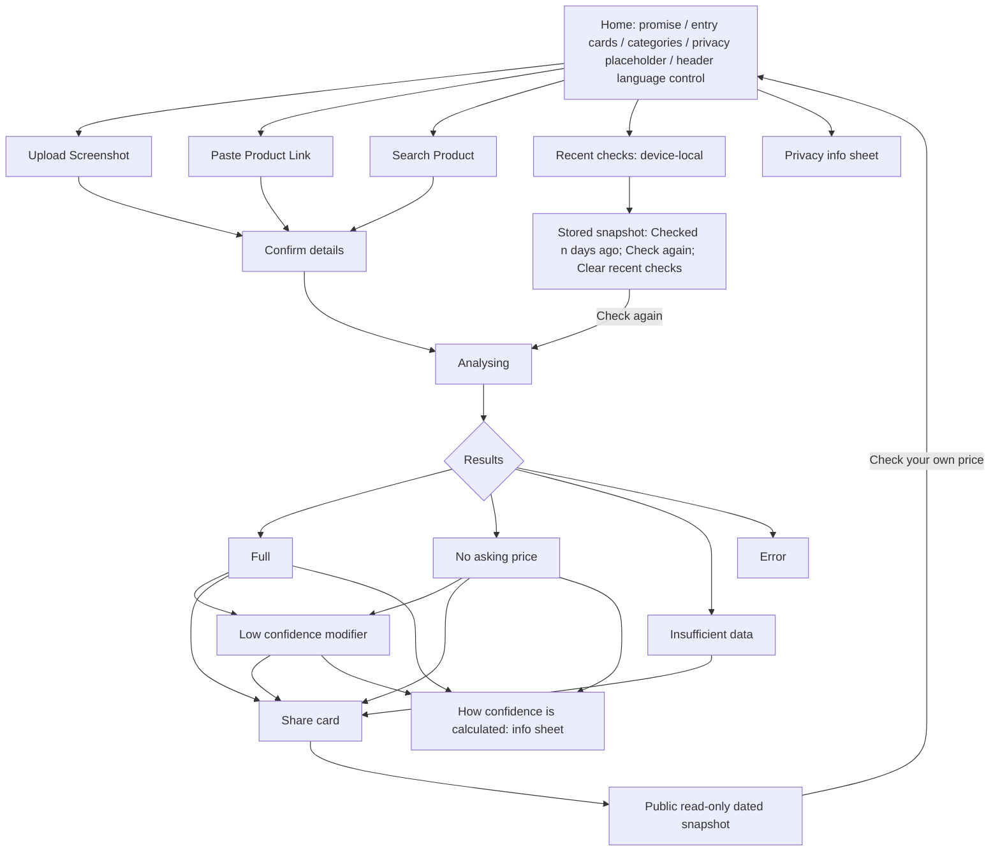
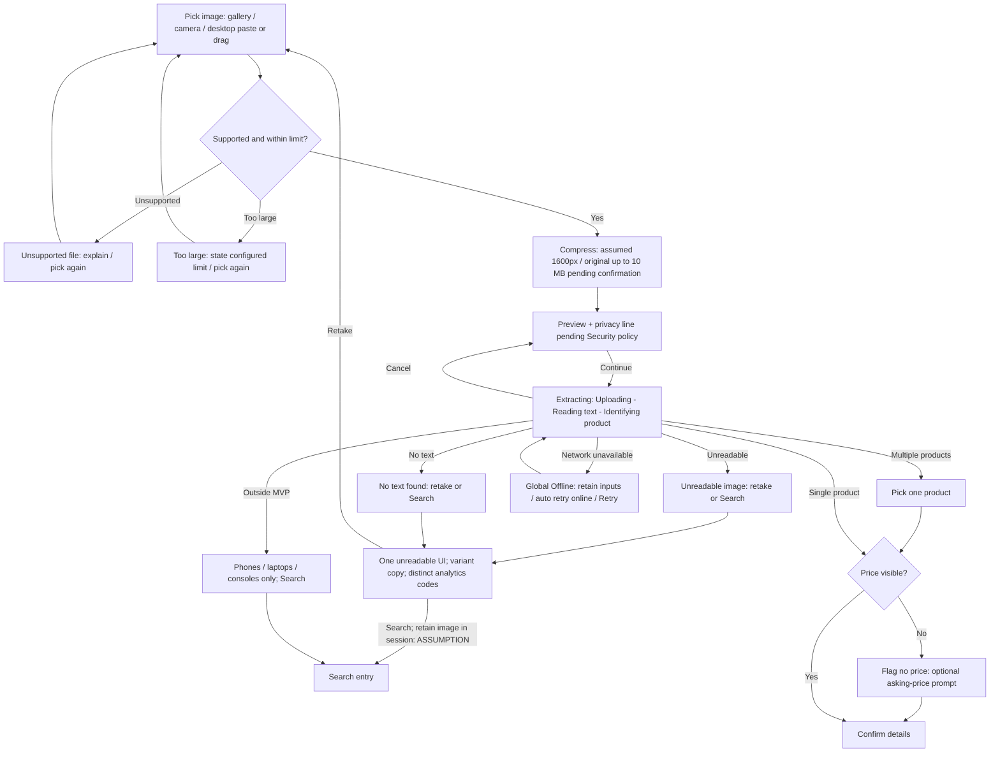
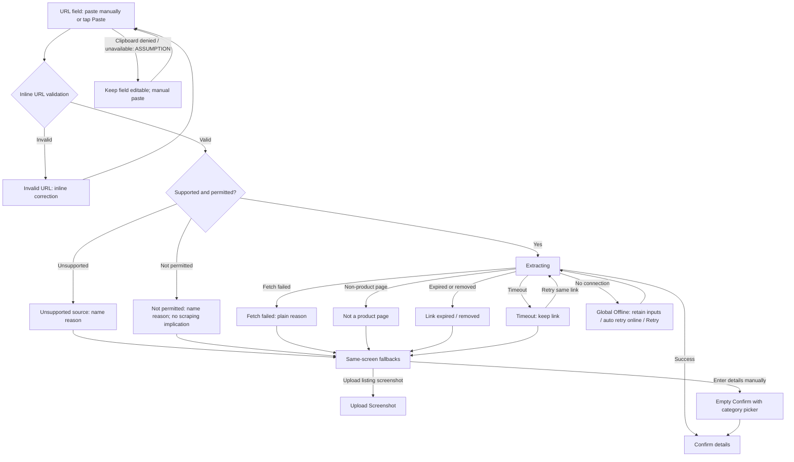
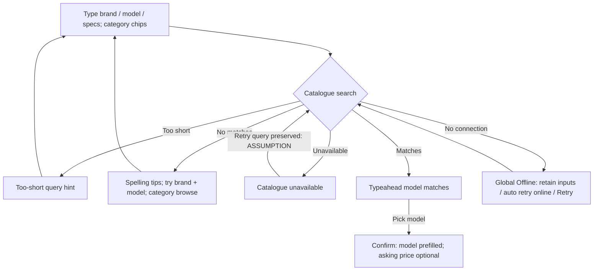
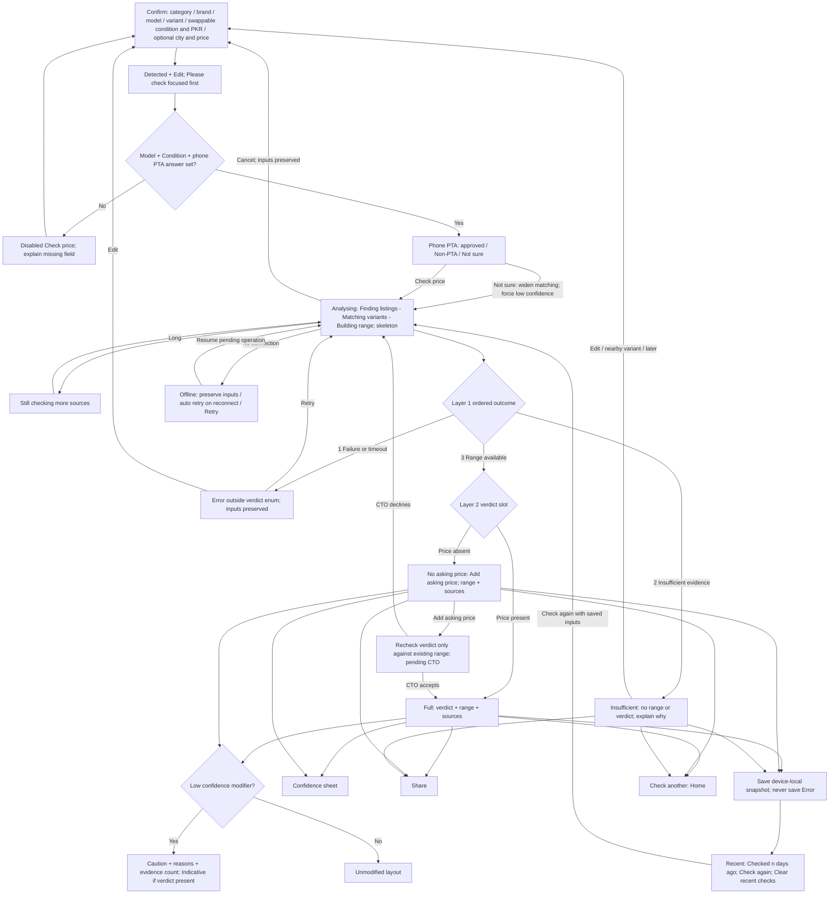
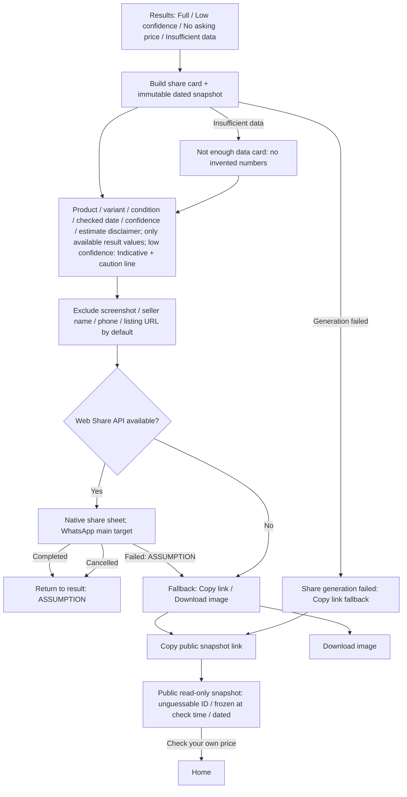

# Day 2 — IA and flows
Working tool: code-based Markdown + Mermaid, with portable SVG/PNG exports (not Figma). Prepared 9 Nov 2026, PKT. Review draft; no approval implied.

Sources read in full: Founder brief (2026-11-09), Design Director Day 1 spec §§1–4. Relative outputs in `flows/`. Diagram node IDs are stable traceability anchors. No real product prices or market evidence are supplied here.

## Assumed defaults
Each is **[ASSUMPTION – pending Founder confirmation]**, supplied by Chief of Staff, not an approved product decision:
- Phone PTA answer required: PTA approved / Non-PTA / Not sure (DD decision, pending Founder ratification). Not sure widens matching and forces low confidence.
- PKR Option A: lakh grouping Rs 1,85,000; Option B: Western Rs 185,000 + x.x lakh helper. Unresolved; swappable UI, not a fixed decision.
- Condition Option A: New/Used/Refurbished/Kit-Open box; Option B: New/Used + Like new/Good/Fair grades. Unresolved; swappable UI.
- English-only launch; Urdu architecture and RTL readiness.
- No brand assets exist; Design creates a lean identity.

Other assumptions: original compression limit/size targets and share dimensions remain provisional; DD-decided outcome order is Error → Insufficient → Range available; range has asking-price-dependent verdict slot and independent low-confidence modifier. A low-confidence range without asking price has a caution banner, reasons and evidence count; adding price produces an Indicative verdict. Retry preserves entry payload and confirmed edits in the current session; switching from failed screenshot extraction to Search retains the image only in-session, not in public output. Clipboard-denial handling, catalogue retry, share cancellation/failure handling and lightweight inline verdict reclassification is pending CTO (fallback full Analysing). No retention duration is promised.

## Diagrams

### 01-ia

[SVG](flows/01-ia.svg) · [PNG](flows/01-ia.png)

### 02-entry-a

[SVG](flows/02-entry-a.svg) · [PNG](flows/02-entry-a.png)

### 03-entry-b

[SVG](flows/03-entry-b.svg) · [PNG](flows/03-entry-b.png)

### 04-entry-c

[SVG](flows/04-entry-c.svg) · [PNG](flows/04-entry-c.png)

### 05-confirm-results

[SVG](flows/05-confirm-results.svg) · [PNG](flows/05-confirm-results.png)

### 06-share

[SVG](flows/06-share.svg) · [PNG](flows/06-share.png)

## State inventory and API dependencies — revised after DD review
CTO references are Design Director §4 item numbers, not existing endpoints. Entry-state rows group codes only where the visible pattern is shared.

|Screen/state|Trigger / visible content|Primary / secondary actions|Payload/API dependency|
|---|---|---|---|
|Home H|Open; three entry cards, categories, header language, privacy placeholder|Choose entry / Recent|§4.8–10|
|Recent REC/STORED/RC|Reopen stored snapshot; Checked n days ago, never current|Check again / Clear recent checks|§4.10; save Full, Low, No-price, Insufficient only; never Error|
|Privacy PRIV|Open sheet; policy placeholder only|Dismiss|§4.7 Security policy pending|
|Upload A0,A1,A4|Pick/validate/compress; limits provisional|Pick / cancel|§4.7,9 configured limits|
|Unsupported A2 / too large A3|Invalid type/size; actual limit shown|Pick again|§4.9 validation config|
|Preview A5|Valid image; [Privacy line, pending Security policy]|Continue / pick again|§4.7 no privacy promises|
|Extracting A6|Upload/read/identify progress|Cancel / wait|§4.2,4; OFF for network loss|
|Unreadable AU; codes A7/A8|Unreadable image OR no text variant copy; one UI|Retake / Search|§4.2 distinct analytics codes|
|Outside category A9|Unsupported product category|Search|§4.3 category config|
|Multiple A10|Multiple candidates|Pick one|§4.2 candidates required|
|No visible price A11/A12|Extracted product without price|Optional price / continue|§4.2 flag, §4.1 nullable asking price|
|URL B0/B1/B2/BP|Inline validation; invalid URL or clipboard unavailable [ASSUMPTION]|Correct / manual paste|§4.5 URL handling|
|Link extraction B3/B6|Supported/permitted URL|Wait|§4.2,4,5; OFF for no connection|
|B4 unsupported / B5 not permitted / B7 fetch failed|Distinct honest reason; same-screen fallback|Screenshot / Manual Confirm|§4.5 reason codes|
|B8 non-product / B9 expired-removed / B10 timeout|Distinct reason, link retained|Retry timeout / screenshot or manual|§4.5 extensions required|
|Fallback FB/BM|Cannot read source; category picker in empty Confirm|Upload / manual entry|§4.2,3|
|Search C0/C1/C5|Catalogue typeahead and category narrowing|Pick / refine|Catalogue contract + §4.3; OFF for no connection|
|C2 short / C3 no matches / C4 unavailable|Hint OR tips+browse OR service error|Type / browse or retry preserved query [ASSUMPTION]|Catalogue query/error contract missing|
|Confirm CF/CD/CV/CX/CP|Detected/Edit; Please check focus; disabled CTA with missing-field reason|Check price / edit|§4.2,3; requires model+condition+phone PTA answer; Not sure widens matching and forces low confidence|
|Confirm swappable controls|Option A/B price and condition unresolved|Edit variant|§4.3,8; no fixed taxonomy or grouping decision|
|Analysing AN/AL|Real steps, skeleton; Still checking more sources|Cancel preserves inputs|§4.4; OFF on network loss|
|Global OFF|Network unavailable; inputs retained|Retry / auto-retry when online|Job resume/retry contract needed for A6,B6,C1,AN|
|Full RF|Range available + price; verdict/range/evidence/provenance|Share / Check another|§4.1 result payload|
|Low confidence RL modifier|Range available, with or without price; banner/reasons/count; Indicative verdict if present|Share / confidence info|§4.1 confidence reasons; Not sure PTA forces modifier|
|No asking price RN|Range available; Add asking price instead of verdict|Recheck verdict only / Share|Existing-range lightweight reclassification pending CTO; fallback AN|
|Insufficient RI|No range/no verdict; evidence explanation and next steps|Edit / nearby variant, later, Share|§4.1 INSUFFICIENT_DATA; beats low confidence|
|Error RE|Failure/timeout; outside verdict enum|Retry / Confirm with inputs|§4.4 job error; no recent save|
|Confidence CI/CONF|Info sheet; methodology explanation|Dismiss|§4.1 reasons/counts; CTO methodology|
|Share SH/S0/SAFE/REDACT/SI|Only available values; insufficient no numbers; low confidence Indicative + caution|Web Share / copy or download|§4.6 immutable public snapshot, no screenshot/seller data|
|Native/fallback S1–S6/GF|Native API first; generation failed -> Copy link|Share / Copy link, Download image|§4.6 snapshot URL must survive image generation failure|
|Public S7/SNAP|Frozen dated read-only snapshot|Check your own price|§4.6 unguessable immutable server page|

## Traceability: Design Director §1 → diagram nodes
- §1.0: header/promise/three entries/category chips/privacy = 01:H; language = 01:H header control; local recent checks = 01:REC. Language is a header control, not a destination. Header logo is a content slot; identity remains assumed.
- §1.1: pick/compress/preview = 02:A0,A1,A4,A5; upload/read/identify/cancel = A6→A5; unsupported = A2; too large = A3; unreadable = A7; no text = A8; no price = A11,A12→CF; outside MVP = A9; multiple products = A10. All converge on Confirm directly or via Search.
- §1.2: paste/inline validation = 03:B0,B1,B2; supported/permitted extraction = B3,B6; unsupported/not permitted/fetch failed = B4,B5,B7; fallbacks = FB,A0,BM; non-product = B8; removed/expired = B9; timeout with preserved-link retry = B10→B6; Confirm = CF.
- §1.3: query/typeahead/category chips = 04:C0,C1,C5; picked model/optional asking price = CF; no matches/tips/browse = C3; short hint = C2; unavailable = C4.
- §1.4: shared fields = 05:CF; Detected/Edit and low-confidence focus = CD; category variants/condition/PKR = CF,CP; optional price and no-verdict outcome = RN; minimum validation/disabled reason = CV,CX.
- §1.5: steps/skeleton = 05:AN; long-running = AL; cancel preserving inputs = AN→CF.
- §1.6: Full = 05:RF; Low confidence = RL; No asking price/inline addition = RN; Insufficient/no numbers/next steps/share = RI; Error/retry/back = RE.
- §1.7: native share = 06:S1,S2; fallback = S4,S5,S6; card fields and exclusion policy = SAFE,REDACT; insufficient card = SI; dated immutable public page + own-check CTA = S7→H. Provisional image dimensions retained as [ASSUMPTION]: 1080×1350 and 1200×630 preview.

## Review log
Design Director: **APPROVED WITH CHANGES** (9 Nov 2026, PKT). Applied:
1. Two-layer result model: four outcomes (Error, Insufficient, Full, No price), plus low-confidence modifier on either range layout; Error outside enum.
2. Phone PTA answer required: approved / Non-PTA / Not sure; Not sure widens matching and forces low confidence (pending Founder ratification).
3. Conflicting price and condition defaults retained as Option A/B, swappable controls.
4. Preview/privacy copy replaced with policy placeholders; no promises.
5. Global OFF state referenced from A6, B6, C1, AN; preserve inputs, reconnect auto-retry, manual Retry.
6. Unreadable/no text share AU UI with distinct A7/A8 analytics codes.
7. Recent saves successful outcomes including Insufficient, excludes Error; stored dated snapshot, Check again, Clear recent checks.
8. Low-confidence share includes Indicative + caution; generation-failed -> Copy link.
9. Inline asking-price action rechecks verdict only against existing range, pending CTO; fallback AN.
10. Language is a Home header control, not destination.

## Open questions and gaps
- PTA DD decision awaits Founder ratification; CTO owns widened-match/forced-confidence mechanics.
- Price Option A [ASSUMPTION – pending Founder confirmation]: lakh grouping Rs 1,85,000. Option B (DD): Western Rs 185,000 + x.x lakh helper. Neither fixed in Confirm.
- Condition Option A [ASSUMPTION – pending Founder confirmation]: New/Used/Refurbished/Kit-Open box. Option B (DD): New/Used with Like new/Good/Fair grades. Neither fixed in Confirm.
- English-only launch with Urdu/RTL architecture and Design-created lean identity remain [ASSUMPTION – pending Founder confirmation]; confirm Urdu timing and brand approval.
- CTO: evidence thresholds, catalogue query/error/candidate contracts, expired/removed/timeout codes, offline retry idempotency, confidence methodology, lightweight verdict reclassification.
- Security: upload limits, actual retention, redaction enforcement, snapshot lifecycle and policy copy. No user-facing privacy promise approved.
- Share copy/download failures and invalid snapshot behavior remain unspecified. Snapshot URL availability if image generation fails needs API support.
- Compression sizing and share 1080×1350 / preview 1200×630 remain source assumptions. No numerical market claim is supplied.

Traceability addendum: OFF references A6/B6/C1/AN; AU merges A7/A8; CP includes Not sure; RA is layer-2 slot; LC/RL modifies RF or RN; VR is inline reclassification; GF is generation-failed copy fallback; STORED/REC are dated saved results. All §1 states remain covered; original §1 five result states are preserved visually but low confidence is now a modifier, not a mutually exclusive outcome.

## Wireframe node anchors

### Node H
See the Mermaid diagram node `H` above and its state inventory row.

### Node A0
See the Mermaid diagram node `A0` above and its state inventory row.

### Node A5
See the Mermaid diagram node `A5` above and its state inventory row.

### Node A6
See the Mermaid diagram node `A6` above and its state inventory row.

### Node A2
See the Mermaid diagram node `A2` above and its state inventory row.

### Node A3
See the Mermaid diagram node `A3` above and its state inventory row.

### Node AU
See the Mermaid diagram node `AU` above and its state inventory row.

### Node A9
See the Mermaid diagram node `A9` above and its state inventory row.

### Node A10
See the Mermaid diagram node `A10` above and its state inventory row.

### Node A12
See the Mermaid diagram node `A12` above and its state inventory row.

### Node B0
See the Mermaid diagram node `B0` above and its state inventory row.

### Node B6
See the Mermaid diagram node `B6` above and its state inventory row.

### Node FB
See the Mermaid diagram node `FB` above and its state inventory row.

### Node B2
See the Mermaid diagram node `B2` above and its state inventory row.

### Node B8
See the Mermaid diagram node `B8` above and its state inventory row.

### Node B9
See the Mermaid diagram node `B9` above and its state inventory row.

### Node B10
See the Mermaid diagram node `B10` above and its state inventory row.

### Node C0
See the Mermaid diagram node `C0` above and its state inventory row.

### Node C5
See the Mermaid diagram node `C5` above and its state inventory row.

### Node C3
See the Mermaid diagram node `C3` above and its state inventory row.

### Node C2
See the Mermaid diagram node `C2` above and its state inventory row.

### Node C4
See the Mermaid diagram node `C4` above and its state inventory row.

### Node CF
See the Mermaid diagram node `CF` above and its state inventory row.

### Node BM
See the Mermaid diagram node `BM` above and its state inventory row.

### Node AN
See the Mermaid diagram node `AN` above and its state inventory row.

### Node RF
See the Mermaid diagram node `RF` above and its state inventory row.

### Node RL
See the Mermaid diagram node `RL` above and its state inventory row.

### Node RN
See the Mermaid diagram node `RN` above and its state inventory row.

### Node RI
See the Mermaid diagram node `RI` above and its state inventory row.

### Node RE
See the Mermaid diagram node `RE` above and its state inventory row.

### Node OFF
See the Mermaid diagram node `OFF` above and its state inventory row.

### Node SH
See the Mermaid diagram node `SH` above and its state inventory row.

### Node SAFE
See the Mermaid diagram node `SAFE` above and its state inventory row.

### Node S7
See the Mermaid diagram node `S7` above and its state inventory row.

### Node GF
See the Mermaid diagram node `GF` above and its state inventory row.

### Node REC
See the Mermaid diagram node `REC` above and its state inventory row.

### Node CI
See the Mermaid diagram node `CI` above and its state inventory row.

### Node PRIV
See the Mermaid diagram node `PRIV` above and its state inventory row.
