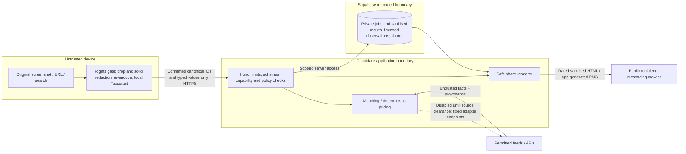

# Kitne Ka — threat model v1
**Security & DevOps / independent AppSec recommendation · 9 Nov 2026 PKT**  
Decision draft due 18:00 PKT today; launch 22 Nov. Architecture proposed, not implemented or security-approved. No scans, tests, deployments, signups or purchases performed.

## Reconciliation update — 9 Nov 2026 PKT
Current agreed **design**, not deployed controls: browser-only pinned/self-hosted Tesseract; **all submitted fields require confirmation**; images/raw OCR stay on device; remote images/models OFF with no model keys. Only independently validated canonical fields cross the API. Unresolved state≤1h, sanitised check≤24h, consented share≤30d/earlier rights expiry; creation-based TTLs. Read [independent CTO review](review-cto-reconciliation-v1.md) for remaining launch conditions. Earlier optional model/provider controls below are **future reactivation gates**, not launch tasks or budget requests. Revoked/expired HTML+PNG return410 while tombstone exists, then404; valid creator revoke replay204. No promise that physical backups or third-party previews obey active-row TTLs. Separate Supabase projects remain our default; any alternative requires explicit SecOps approval.

## Basis and scope
Governing input: [Founder brief](../founder-product-brief-2026-11-09.md), especially §§3,5–7. Technical basis: CTO [ADR-0002](../cto/ADR-0002-architecture-and-stack.md), [API SecOps v0.3 and subsequent v0.4/v0.5 revisions](../cto/03-api-contract-v0.md), [methodology v0.1](../cto/02-pricing-methodology-v0.1.md), [source matrix](../cto/01-data-source-matrix.md), and remaining CTO summary/repo/foundations/cost/reconciliation documents. Supporting `cto/evidence/` is public research, not evidence of working controls or production access. Later revision sections govern conflicting earlier types.

Journey: open → screenshot / pasted URL / catalogue search → extraction → confirm all submitted product/variant/condition/price fields → gather **permitted** evidence → exclude incompatible variants → deterministic range or Insufficient market data → result with sources/dates → explicit sanitised share. Initial categories phones/laptops/consoles; Pakistan/PKR is still an assumption awaiting Founder approval. No-account checks do not mean unauthenticated access to private jobs.

Assets: screenshot names/phone numbers/chats, private OCR/URLs/asking prices, job capabilities, revocation tokens, provider credentials, evidence integrity, public snapshots, availability and spend. Attackers: anonymous bots, malicious uploaders/sellers, poisoned sources/model output, leaked-link recipients, compromised dependencies/CI or privileged operators.

## Data flow / trust boundaries

Browser assertions, OCR/model output and upstream content are never authoritative. Crossing device→Worker, Worker→DB, Worker→permitted source and private→public requires independent validation. Local OCR must not download executable code dynamically from unpinned third parties; bundle/self-host pinned WASM/language assets. Original images must not reach logs, static assets, service-worker caches or database.

## STRIDE-lite register
Likelihood/impact are **pre-control** qualitative estimates (L/M/H), not measured exploit probabilities. S spoofing; T tampering; R repudiation; I information disclosure; D denial of service; E elevation. **B** = launch blocker for the affected enabled path; disabling that path explicitly is an acceptable containment, not a claim of complete remediation. CTO owns architecture choices; Engineer implements; SecOps verifies evidence.

| ID / step / STRIDE | Threat; L/I | Required mitigation and acceptance evidence | Owner | Gate |
|---|---|---|---|---|
| T01 screenshot → extraction; I | Names, phone numbers, WhatsApp status header/chats/GPS leak; H/H | Rights/origin question before OCR per CTO policy. Local crop and opaque, flattened redaction before any upload; local OCR may suggest PII boxes but cannot guarantee detection. Explicit preview for remote processing. Launch sends no images/raw OCR; all submitted fields confirmed. Server resolves IDs/enums/ranged numbers against category config; no arbitrary model/spec/city strings. Treat GET search queries, error params and legacy URL classification as separate transient-input/logging risks; confirmation does not prove absence of PII. No raw OCR persistence. No PII in logs, traces, exception payloads or shares. Seed synthetic phone/name/EXIF canaries and inspect every sink. | Engineer; SecOps | B |
| T02 upload; T/D/E | Spoofed MIME, malformed containers/polyglots, huge/decompression-bomb image or vulnerable decoder; H/H | Apply independent byte/type/container/dimension controls below, not extension/Content-Type trust. Launch rejects image ingress. Future feature requires isolated server-controlled safe decode/re-encode/metadata stripping as well as independent validation; a client re-encode or header-only parser is insufficient. No native edge decoder or public original download. Oversize/chunked/truncated/animated inputs rejected before provider calls. | Engineer; CTO | B if remote image route enabled |
| T03 file storage; I/E | Public bucket, guessed path, long-lived signed URL exposes uploads; M/H | **No screenshot object storage in MVP**. Deny all browser upload/list/read grants. If later storage is approved: private quarantine bucket, RLS, opaque names, authorised minting of ≤60s signed URLs, no list access, no logs/referrers containing signatures; retention deletion via Storage API. Signed URLs are bearer secrets, not proof of safe content. | CTO; Engineer | B; storage feature post-launch unless separately reviewed |
| T04 OCR/Gemini; T/I/E | Image text says “ignore instructions”, exfiltrate keys, fabricate price, inject HTML/URLs; H/H | Treat OCR as bounded untrusted data, separate from fixed system instructions. No tools, browsing, grounding, function calls or credential/context access. Strict structured output + independent Zod validation, unknown keys rejected, bounded strings/arrays/numbers, mandatory user confirmation for all submitted fields. Model cannot change source policy, make market observations or calculate verdicts. Escape text/attributes; **never render model output as HTML**, Markdown-with-HTML, scripts, SQL, SVG or executable templates. Malicious instructions/URLs fixture must cause no outbound request or public HTML execution. | Engineer; CTO | B if fallback enabled |
| T05 pasted URL/source; I/E/D | SSRF, metadata access, internal origin bypass, redirect/DNS tricks; H/H | Default **zero user-target fetches**: current allowlist empty. OLX/Daraz NOT_PERMITTED403 before network; unsupported/unclear sources SOURCE_NOT_SUPPORTED422. No OpenGraph fetch exception. Only clearance-enabled fixed adapters may fetch; network policy below. Test network-spy assertion of zero calls for denied targets. | CTO; Engineer; SecOps | B |
| T06 confirm/check; T/S | Client supplies fake comparables, prices, configuration/version or hidden variant; H/H | Server catalogue/schema validation, confirmed-field checks and independent evidence retrieval; target never its own benchmark. Parameterised queries; bounded arrays and money integers. No browser writes to observations/catalogue/policy. Separate protected admin/offline import, rights/provenance and formula-injection-safe CSV handling. Synthetic fixtures never production evidence. | Engineer; CTO | B |
| T07 private jobs/check/classify/cancel; S/I/T/E | IDOR or stolen/replayed token reads/cancels/classifies others; H/H | Separate ≥128-bit CSPRNG capabilities, store token hashes, constant-time verification, resource/action/expiry scope, ≤24h private TTL. Auth header, never URL/Recent/analytics/OG metadata; hash all high-entropy capabilities at rest, including revocation tombstones. Referrer-Policy:no-referrer and header/body/query redaction at every sink, including provider-generated invocation/access logs; no literal tokens or token fragments in SQL/RPC errors. IDs alone give no access. Same-origin CORS, Origin checks on mutations; if cookie auth chosen require HttpOnly/Secure/SameSite plus CSRF defence. Two-session negative tests across every endpoint and DB role; no private response caching. | Engineer; SecOps | B |
| T08 jobs/providers; D/T/R | Parallel advances/offline retries double bill, cancellation lies or unpaid background run; H/H | Atomic DB stage lease + scoped idempotency, compare-and-set version and unique provider-operation reservation. A timeout of uncertain billing must not blindly rerun a paid call. classify uses retained evidence only, no model/source invocation; reject expired/stale state. Cancellation aborts local work best-effort; explicitly disclose vendor limits. | Engineer; CTO | B |
| T09 share; S/I/T | Enumeration, public PII, writable snapshots or revoke token leak; H/H | ≥128 random bits CSPRNG URL-safe share IDs, never sequential; independent revoke token hash, immutable server-built safe field allowlist, explicit preview/public consent. Supabase RLS denies direct anon access; Worker checks expiry/revocation on every HTML/PNG request. No share list/search endpoint; noindex/nofollow/noarchive plus robots guidance (not confidentiality). Referrer-Policy:no-referrer, no third-party analytics/fonts; no seller/target URL/OCR/image/PII. Ask price off by default. Revoke/expiry tests HTML and OG image paths, conditional304/HEAD/Range and query/locale variants. State gate before every response, first-party no-store/cache bypass;410 revoked/expired while tombstone retained, then404. Never rely on local cache.delete as global purge. See review for global purge/third-party cache limits. | Engineer; SecOps | B |
| T10 public/anonymous actions; D | Bots exhaust Worker/DB/share renderer; H/H | Layered per-IP and per-device/session throttles below; cap JSON/body/query/page/job counts, poll with Retry-After/backoff; bound PNG rendering and cache only safe assets under revocation-aware rules. Turnstile step-up verified server-side; no credit for an unchecked client widget. | CTO; Engineer | B |
| T11 optional Gemini; D/I | Budget exhaustion, free-tier data reuse, unsupported audience; H/H | Paid-project/no-product-improvement verification; vendor notice and explicit remote choice; strict central atomic cost reservation + token/output caps, daily/monthly hard stop and kill switch. Google terms include under-18 audience restriction and abuse-monitoring retention: see privacy proposal. No enablement until audience/region/privacy/budget approved. | CTO; SecOps | B if enabled |
| T12 secrets/CI; I/E/T | Frontend build embeds service key; workflow/dependency steals deployment secrets; M/H | Wrangler secret bindings per environment; no VITE_* privileged keys, `.env` commits, preview prod secrets or PR secret access. Supabase service-role key **never browser**; preferably narrower runtime role, separate migrator/admin credentials. Browser anon/publishable key is public only with tested RLS. Gemini key server-side only, restricted API/project. Pinned dependencies/actions, least privilege, rotation and CI baseline below. | SecOps; Engineer; CTO | B |
| T13 result/cache/source; T/R | Poisoned evidence, stale cache or misleading confidence harms buying decisions; H/H | Disabled-by-default policy registry + kill switch and licence expiry. Enforce exact variant/PTA/condition, independence, provenance, freshness and deterministic thresholds. Unknown PTA branches separate, n2+n2 insufficient. Immutable versioned evidence/checked_at; stale classify rejects, no hidden spend. No source outage disguised as insufficient. | CTO; Engineer | B |
| T14 diagnostics/retention; I/R | Logs persist private payloads or cleanup silently fails; H/H | Allowlisted event schema only (request ID, route template, status, timing, reason counts). Never log URL queries, share IDs, capabilities, OCR, image/base64, names/numbers or raw provider errors. Retention predicates on reads plus scheduled deletion + monitored overdue counts. Restrict operator access; record administrative/config changes without payloads. | SecOps; Engineer | B |
| T15 supply chain/device; E/I | Compromised OCR asset, XSS/PWA cache steals local inputs; M/H | Pinned/self-hosted scripts/WASM, CSP with minimal worker/wasm exceptions verified on supported browsers; no unsafe-inline/eval unless narrowly justified by reviewed tooling. HSTS on controlled HTTPS hosts, nosniff, frame-ancestors none, Permissions-Policy. Static shell cache only, clear object URLs/buffers and no screenshot IndexedDB/Recent. | Engineer; SecOps | B |
| T16 ongoing hardening; D/R | Distributed evasive abuse, security drift, incident response delays; M/M | After baseline: tune shared-NAT false positives, wider adversarial corpus, independent pentest, richer anomaly detection, restore exercises and periodic rights/vendor reviews. Basic kill switches, escalation owner and rollback are launch requirements, not deferred. | SecOps; CTO | Post-launch enhancements |

## Future upload security profile — OFF at launch, separate approval required
- Preserve CTO's **10MiB client original** cap; additionally propose ≤20MP and ≤8192px per side before decode, single frame, browser Web Worker timeout/cancel and manual fallback on low-memory devices. Header checks precede decode; browser decoder risk is not eliminated by JavaScript isolation.
- Client accepts JPEG/PNG/static WebP; converts allowed input to flattened **JPEG or PNG only** after crop/redaction, target ≤1600px long edge. Reject SVG, GIF/APNG, PDF, archives, animated WebP, remote file references and arbitrary URLs. Re-encoding discards EXIF/GPS/XMP/text chunks and original filename. Do not blur sensitive text or retain editable redaction layers.
- Server: one image ≤4MiB, ≤4MP, each side ≤4096px (1600px is a client target, not proof); proposed total multipart body ≤4MiB+64KiB overhead, JSON≤64KiB; raw OCR text submissions forbidden at launch. Future provider input bounds require a separate review. Count actual streamed bytes even without Content-Length; reject request content-encoding other than identity. Enforce framing, magic-byte MIME sniffing, dimensions, chunk/segment lengths, frame count and complete EOF/trailing-data rejection with a maintained bounded parser. Reject unexpected metadata-bearing PNG chunks/JPEG segments rather than trusting “normalised:true”. Size alone does not stop bombs; pixel count + frame count + parser time/memory bounds do.
- **Agreed stronger control:** no image ingress at launch. Any future enabled route must use an independently reviewed isolated **server decode/re-encode/metadata-strip** pipeline in addition to byte/container/pixel/frame/time bounds. Independent header validation alone does not replace it. No unsafe native decoder on the free Worker; if a safe pipeline is infeasible, keep ingress disabled. New processing services require Founder privacy/vendor/spend approval.
- Malware posture: no general file hosting, no original stored/served, no executable formats, no native shell/decoder, patched pinned libraries. **No AV scan is claimed or promised**; re-encoding/type validation is not antivirus. Any future persisted/quarantine-original path requires isolated decode/re-encode, malware scanning before release, private storage and approval. PII redaction and validation remain required even if AV is added.

## URL egress policy / Workers-specific constraints
**Recommended launch default: Worker never fetches a raw pasted URL.** Parse for policy classification locally/server-side without resolving it. Permitted feeds/API base URLs are operator configuration, not client-controlled proxy targets. Enabling a target adapter later is a new security gate:
1. WHATWG URL parse; HTTPS/443 only, no credentials/fragments, exact normalised hostname and endpoint/path/query-key allowlist, no suffix-string checks. Reject IP literals, encoded/alternate IPv4 forms, localhost/internal names and any user-supplied Host, `cf.resolveOverride`, proxy or service-binding destination.
2. Block loopback, RFC1918, IPv6 ULA/link-local, IPv4/IPv6 mapped encodings, metadata/link-local (including 169.254.169.254), CGNAT, multicast, unspecified and other reserved/non-public ranges **after DNS resolution at connection time**, not a stale DNS pre-check. Reject any disallowed answer and DNS rebinding. Worker global fetch does not expose a conventional Node DNS+socket pinning guarantee; do not invent one. Use fixed trusted provider hosts and verify deployed egress behaviour; if that guarantee cannot be demonstrated, keep target-fetch disabled or separately review an egress control service.
3. Set `global_fetch_strictly_public`; official docs say this prevents same-zone origin routing that bypasses front-door security. This is defence-in-depth, **not a replacement for allowlists or proof all SSRF is solved**. Do not route user input through service bindings, raw sockets, browser rendering, or `resolveOverride`. Local development is not evidence of production egress safety.
4. `redirect:'manual'`; default deny redirects. If a source demonstrably requires them: ≤2 hops, revalidate URL/policy/resolved destination at every hop; never downgrade HTTPS or forward credentials to a different origin. Construct fresh outbound headers, never copy inbound Cookie/Authorization. Workers defaults and compatibility flags matter; pin/test them.
5. Proposed per-fetch 5s timeout (within 15s stage), 1MiB **decoded** body cap via streaming counter plus content-encoding handling, content-type allowlist, bounded parser and no scripts/subresource/image loads. Abort oversized streams; Content-Length alone insufficient. No secrets in response/error/logs. Source-specific credentials only to their fixed endpoint. Never implement an open proxy.

References checked 9 Nov 2026 PKT: [Workers compatibility flags](https://developers.cloudflare.com/workers/configuration/compatibility-flags/) (`global_fetch_strictly_public` and redirect header stripping); [Request](https://developers.cloudflare.com/workers/runtime-apis/request/) (manual redirects, header forwarding caveats, AbortSignal/compatibility date).

## Anonymous abuse and spend controls
Launch model allowance is **zero**; no provider key/fallback, including on OCR failure. Per-device/IP/create/share/poll limits below remain launch requirements even with no model bill; model-call quotas/reservations below apply only on future approved reactivation. Rendering, DB storage and request abuse still cost availability/resources.
Initial **tunable proposals**, not product-approved quotas: per session/device 5 new checks/minute and 30/day; broad per trusted ingress IP 30 new checks/minute and 300/day (shared Pakistani mobile NAT needs challenge/recovery, not permanent bans). Polling separate: ≤30/minute/job with 2–5s backoff after initial poll. Share creation ≤10/hour/session; public reads ≤120/minute/IP with measured burst allowance. Two concurrent active checks/session; 1 remote model call/check by default, optional retry only if known safe and budget-reserved. Provider calls ≤5/day/device initially. Apply limits to JSON/local OCR as well as multipart; forging a device ID must not buy unlimited global quota.

Use random server-issued first-party device/session identifier, not invasive browser fingerprinting; signed/session-bound and resettable, ≤24h lifetime. IP-derived rate keys use rotating HMAC, not raw IP logging; still pseudonymous data. Trust Cloudflare ingress IP metadata only on the approved path, not arbitrary X-Forwarded-For. Limit/session minting itself and step up with Turnstile on suspicious/expensive actions; verify token hostname/action/expiry server-side. Turnstile is friction, not authorisation or a cost ceiling.

Workers rate-limit bindings are **approximate, per-location**, not strict global counters. Use a single atomic Postgres quota/reservation function (narrow server permission; row-lock/transaction) before paid calls, not Worker memory or eventually-consistent edge counters. Proposed Gemini cap from CTO: $10/month within unapproved $15 Worker+extraction envelope; additionally propose $1/day, 50 calls/day globally and bounded input/output tokens at approved model rates. Reserve worst-case billable amount before dispatch; retain reservation on uncertain outcome, reconcile without replay, include retries/thinking/image tokens. Alert at 50/80/100%; fail closed if reservation unavailable; billing alerts are not hard caps. These are app controls, not a promise to cap a compromised vendor account's bill. Use vendor quotas too; separate key/project; disable fallback at cap with manual route.

[Workers Rate Limiting](https://developers.cloudflare.com/workers/runtime-apis/bindings/rate-limit/) and [Turnstile plans](https://developers.cloudflare.com/turnstile/plans/) checked 9 Nov 2026 PKT. Turnstile Free lists unlimited challenges; Enterprise is paid. Verify actual Worker binding/WAF entitlements and account limits before setup; WAF advanced rules, Durable Objects, paid Workers, Enterprise Turnstile or new observability are **Founder approval/cost items**, not assumed free or authorised. Prefer atomic existing Postgres over new infrastructure for strict spend control.

## Secrets and incident minimum
Wrangler secrets for runtime DB/capability-HMAC keys (no Gemini/model key at launch; server-side only on future approved reactivation), separate preview/prod; environment-scoped CI deployment tokens with minimal Cloudflare account/Worker rights, not Global API Key. Supabase RLS on every exposed table; revoke anon access to private jobs, observations and policy; expose only safe views if truly needed. A public anon key without RLS is not safe. Service-role bypasses RLS: server object-level checks remain mandatory, and a narrowly privileged runtime DB role is preferred. Separate import, migration and deletion-job credentials. No privileged key in frontend bundles/source maps, logs, fixture files or CI artifacts. Secret-scanner negative tests must include built output.

Inventory owner/scope/last-rotation without values. Proposed rotation before launch and every 90 days; immediately revoke/rotate on leak, departing privileged access or suspicious use. Test staged two-key rotation for capability signing; incident rotation invalidates sessions as needed. MFA for cloud/source-control operators. SecOps incident checklist: disable affected fallback/source/share publish, preserve only sanitised audit metadata, revoke keys/tokens, assess disclosure, CTO restore/rollback, Founder/legal decide notifications. No invented universal statutory breach deadline.

## Top 10 launch-blocking checklist (evidence, not promises)
1. **PII boundary:** redaction preview and no raw input/PII/secrets in logs, shares, PWA caches or persisted OCR; synthetic canary sink test.
2. **Upload safety:** prove image ingress OFF at launch, with bounded415 rejection. Future enablement requires isolated server decode/re-encode/metadata stripping plus independent stream/type/container/pixel/frame checks and measured runtime budget.
3. **SSRF/rights:** empty-by-default approved adapter registry; restricted/unknown pasted links trigger zero network calls; any enabled adapter passes egress/redirect/DNS tests.
4. **No-account authorisation:** every private operation capability-scoped; cross-session negative tests and DB RLS denial, including classify/cancel/share creation.
5. **Public share safety:** ≥128-bit IDs, safe allowlist/public opt-in, no target PII, expiry+revocation enforced for HTML/PNG; no direct bucket/DB bypass.
6. **Model containment:** prove no remote model calls/credentials/fallback at launch and malicious local OCR has no authority; future approval additionally requires tools/grounding off, strict output schemas/encoding and no model-created market evidence.
7. **Provider eligibility/privacy:** Gemini remains off until age/audience/region, paid-project terms, 55-day abuse retention and policy-enforcement model-use caveat are accepted/disclosed.
8. **Abuse/cost:** per-session/IP/create/share/poll limits, global resource caps and server Turnstile validation where used; idempotency under parallel retries. Atomic paid-call reservations required only for future provider enablement; launch model allowance zero.
9. **Secrets/release chain:** no privileged browser keys; scoped separate env credentials; required CI gates/reviews and a tested rollback/kill-switch route.
10. **Retention/integrity readiness:** approved retention notice and verified deletion/read-expiry controls; permitted real evidence pathway or explicit Founder scope decision. Fixtures do not prove market coverage.

All ten require named evidence at G4 (21 Nov PKT). G2 (12 Nov) must resolve architecture/privacy/runtime/source feasibility; G3 freeze 18 Nov. No claim that any checklist item has passed.

## Independent challenges / open questions
- Agree with modular monolith, browser-first OCR, no screenshot storage, no tools and disabled source adapters. Do **not** treat the CTO's 10ms free-Worker parser/PNG CPU assumption as security evidence. CTO now agrees: no ingress at launch, isolated server decode/re-encode required before future enablement; client-only normalisation is not enough.
- Tighten **24h extraction fields**: raw OCR/provider responses never persisted; minimal unresolved fields 1h. Keep 24h only for sanitised check state/idempotency as justified in the privacy proposal. Thirty-day shares acceptable only explicit, minimised, revocable and never served past evidence validity as live quotes.
- Gemini paid “not used to improve products” does not mean zero retention or literally no ML training: current abuse policy allows policy-enforcement models. Terms also restrict clients likely accessed by under-18s; an unrestricted consumer PWA is not automatically eligible. Local-only is the default pending review.
- A version/preview URL is not environment isolation; do not let a production Worker version URL reach production DB/keys during PR testing. See CI plan.
- S10/S11 not defined as standalone identifiers in supplied CTO authored plans (US10/US11 are product stories, not this mapping). PM/CTO must confirm mapping; no issue status inferred.
- Founder must choose data region/cross-border posture, audience, vendor/budget and retention. CTO must identify runtime DB access method/role (ADR says SQL over HTTPS without final transport), exact parser/rasteriser and deployed egress guarantee. Engineer must define session recovery/delete UI without persisting capabilities in Recent. No code/repo/cloud settings were inspected or changed.

### Change record for reconciliation review
Updated launch flow/diagram to canonical-only browser OCR with all-field confirmation and no remote providers; strengthened future-ingress gate; adopted410/revoke-tombstone semantics; made zero model budget explicit; expanded canonical-field, capability/log, CDN and backup/restore conditions. Detailed owners/evidence are in review-cto-reconciliation-v1.md. No security tests or deployment performed.
